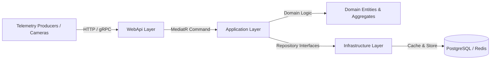

<div align="center">

# ⚡ Sports Telemetry Engine
### High-Throughput Sports Telemetry & Tracking Ingestion Microservice
**Built on .NET 8 · Clean Architecture · Domain-Driven Design (DDD) · CQRS**

[](https://github.com/KevinNaserwan/sports-telemetry-engine/actions)
[](LICENSE)
[](https://dotnet.microsoft.com/)
[](https://learn.microsoft.com/en-us/dotnet/architecture/modern-web-apps-azure/common-web-application-architectures)

</div>

---

## 📌 Overview

**Sports Telemetry Engine** is a high-performance backend microservice engineered in **C# / .NET 8** designed to ingest, process, and broadcast high-frequency tracking telemetry from athletic events (optical tracking cameras, wearable GPS vests, and ball sensors).

### Core Highlights:
- **Sub-Millisecond Ingestion**: Minimal API endpoints tuned for extreme throughput under heavy match-day traffic spikes.
- **Strict Clean Architecture**: Decoupled Domain, Application, Infrastructure, and Presentation layers adhering to Domain-Driven Design (DDD).
- **Spatial Heuristics**: Built-in geometric and proximity algorithms to calculate frame-level possession and turnovers.
- **Cloud-Ready**: Prepared for containerized orchestration with Docker, Kubernetes, Redis pub/sub, and PostgreSQL.

---

## 🏛️ Clean Architecture & CQRS Workflow



---

## 📂 Solution Structure

```
sports-telemetry-engine/
├── src/
│   ├── Domain/                 # Pure domain models (zero external dependencies)
│   │   ├── TrackingFrame.cs    # Frame aggregate root
│   │   ├── PlayerTelemetry.cs  # Player spatial coordinate & speed entity
│   │   └── MatchEvent.cs       # Match domain events & turnovers
│   │
│   ├── Application/            # Use cases, interfaces, and business workflows
│   │   ├── Services/           # ITelemetryProcessor & possession calculation
│   │   └── Validators/         # FluentValidation rules
│   │
│   ├── Infrastructure/         # External concerns (persistence, caching, brokers)
│   │   └── Persistence/        # EF Core DbContext, PostgreSQL & Redis handlers
│   │
│   └── WebApi/                 # ASP.NET Core Minimal APIs & middleware
│       ├── Program.cs          # Dependency injection & pipeline orchestration
│       └── Controllers/        # Telemetry ingestion endpoints
│
├── tests/                      # Unit & integration tests (xUnit, FluentAssertions)
└── .github/workflows/ci.yml    # Automated GitHub Actions build pipeline
```

---

## 🔌 API Specification

### 1. Ingest Tracking Frame
```http
POST /api/v1/telemetry/frame
Content-Type: application/json
```

#### Request Payload:
```json
{
  "matchId": "MATCH_FCB_2027_01",
  "frameIndex": 14205,
  "matchTime": "00:09:28.200",
  "ball": {
    "position": { "x": 52.5, "y": 34.0, "z": 0.2 },
    "speedMps": 12.4,
    "inPlay": true
  },
  "players": [
    {
      "playerId": "P_BARCA_10",
      "teamId": "FC_BARCELONA",
      "jerseyNumber": 10,
      "position": { "x": 51.8, "y": 33.6 },
      "speedMps": 5.8,
      "acceleration": 1.2
    }
  ]
}
```

#### Response (200 OK):
```json
{
  "matchId": "MATCH_FCB_2027_01",
  "frameIndex": 14205,
  "controllingTeamId": "FC_BARCELONA",
  "controllingPlayerId": "P_BARCA_10",
  "confidenceScore": 0.88
}
```

---

## 🚀 Getting Started

### Prerequisites
- [.NET 8.0 SDK](https://dotnet.microsoft.com/download/dotnet/8.0)

### Local Execution
```bash
# Clone the repository
git clone git@github.com:KevinNaserwan/sports-telemetry-engine.git
cd sports-telemetry-engine

# Restore dependencies
dotnet restore src/WebApi/WebApi.csproj

# Run WebApi
dotnet run --project src/WebApi/WebApi.csproj
```

### Run Tests
```bash
dotnet test
```

---

## 👤 Author & License
- **Author**: Kevin Putrayudha Naserwan ([@KevinNaserwan](https://github.com/KevinNaserwan))
- **License**: MIT
